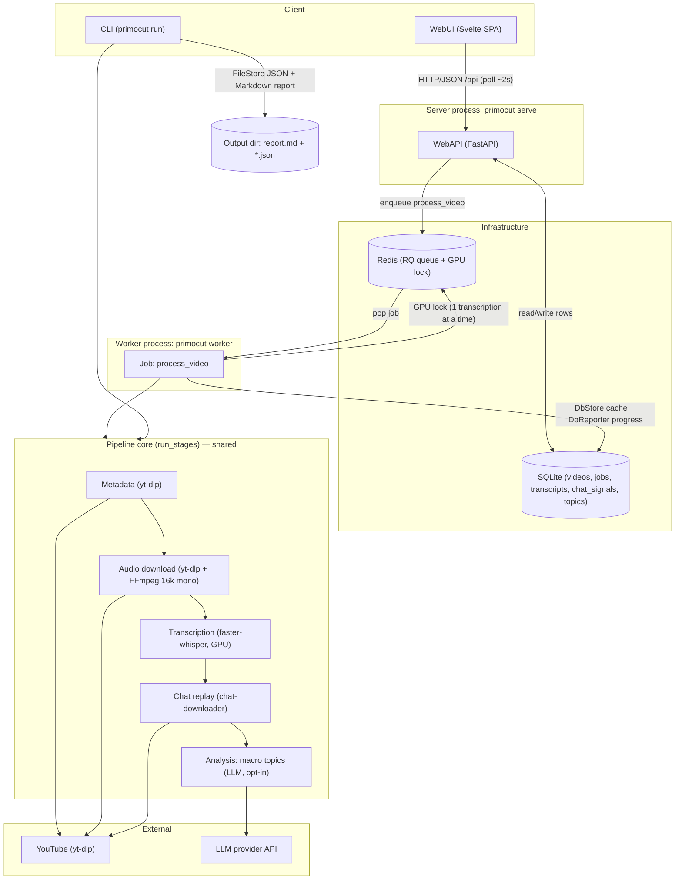

# PRIMOCUT

PRIMOCUT takes the URL of a **YouTube live** and produces a **navigable report** with the full
transcript (clickable timestamps), chat activity (per-minute series + z-score peaks as clip
candidates) and, on demand, an LLM-generated index of macro topics. It solves the problem of
sifting through hours of a live to find what is worth clipping/reviewing: everything is derived
from **real** timestamps, so every `&t=SECONDS` link lands exactly on the moment.

The same pipeline core is exposed two ways: a **CLI** (URL → Markdown report) and a **local web
app** (submit a URL, watch the live status, open the report in the browser).

- Product source of truth: [`docs/PRIMOCUT.md`](docs/PRIMOCUT.md).
- Development source of truth (roadmap, current state, resilience, decision log):
  [`docs/DEVELOPMENT.md`](docs/DEVELOPMENT.md).

> On any contradiction between this README and the code, the **code wins** — and the docs above
> are updated to match.

---

## 1. Architecture overview

PRIMOCUT is a multi-layer system built around **one shared pipeline core** (`run_stages`). No
processing logic is duplicated between the CLI and the web app — they differ only in how they
store artifacts and report progress.

| Layer | Where | Responsibility |
|---|---|---|
| **WebUI** | `frontend/` (built into `src/primocut/webui/dist`) | Svelte SPA: submit URLs, live status list, navigable report + embedded player |
| **WebAPI** | `src/primocut/api/` | FastAPI: REST endpoints, serves the compiled SPA as static files |
| **CLI** | `src/primocut/cli.py` | Typer commands: `doctor`, `run`, `models`, `serve`, `worker` |
| **Queue** | `src/primocut/worker/queue.py` + Redis | Enqueue/re-enqueue/stop/delete videos on an RQ queue |
| **Worker / Jobs** | `src/primocut/worker/jobs.py` (`primocut worker`) | RQ worker; `process_video` job runs the pipeline per video |
| **Pipeline core** | `src/primocut/pipeline.py` (`run_stages`) | Metadata → audio → transcription → chat → analysis |
| **Persistence** | `src/primocut/db/` (SQLite/SQLAlchemy) | Videos, jobs, transcripts, chat signals, topics, migrations |
| **Domain modules** | `download/`, `transcription/`, `chat/`, `analysis/`, `report/` | Stage implementations reused by the core |

### How the layers communicate

- **WebUI → WebAPI:** HTTP/JSON REST under `/api` (in dev, Vite proxies `/api` → `:8000`; in
  production the SPA is served by the same FastAPI process). The UI follows progress by
  **polling** the REST endpoints **every ~2 s** — there is no SSE/WebSocket (single-user
  decision).
- **WebAPI → Queue:** on `POST /api/videos`, the API validates the URL, upserts a `Video`
  (`queued`) + `Job` row in **SQLite**, and **enqueues** `process_video` on the **RQ queue backed
  by Redis**.
- **Queue → Worker:** the `primocut worker` process (RQ `Worker`) pops jobs from Redis and runs
  `process_video`, which drives `run_stages`.
- **Worker → Persistence:** the job writes stage/progress/status, transcript, chat signal and
  topics to **SQLite** via `DbStore` (the pay-once cache) and `DbReporter` (live progress). The
  WebAPI reads those same rows to answer polling requests — SQLite is the only channel between
  worker and API (no direct calls).
- **GPU serialization:** the transcription stage acquires a **distributed lock in Redis**
  (`primocut:gpu`), guaranteeing **one transcription at a time** no matter how many workers run.
  The lock auto-releases (lease `PRIMOCUT_GPU_LOCK_TIMEOUT`, default 2 h) if a worker dies.
- **External services:** metadata/audio come from **YouTube via yt-dlp** (+ FFmpeg for 16 kHz
  mono), chat via **chat-downloader** (yt-dlp `--live-chat` fallback), and macro topics via an
  **LLM provider API** (Anthropic / OpenAI / OpenRouter).
- **CLI path (no queue/DB):** `primocut run` calls the same `run_stages` directly with `FileStore`
  (JSON cache) + `LogReporter`, and writes a Markdown report — no Redis, no SQLite, no worker.

### End-to-end flow



---

## 2. Technology stack

| Concern | Technology |
|---|---|
| Language (backend) | Python **≥ 3.11** |
| CLI | [Typer](https://typer.tiangolo.com/) + [Rich](https://rich.readthedocs.io/) |
| Config | pydantic v2 + pydantic-settings (`.env`) |
| Web API | [FastAPI](https://fastapi.tiangolo.com/) + [uvicorn](https://www.uvicorn.org/) |
| Web UI | [Svelte 5](https://svelte.dev/) SPA, built with [Vite 8](https://vite.dev/) |
| Job queue | [RQ](https://python-rq.org/) (+ `rq-scheduler`) over **Redis** |
| Cache / broker / lock | **Redis** (RQ broker + distributed GPU lock) |
| Database | **SQLite** via [SQLAlchemy 2.0](https://www.sqlalchemy.org/) (simple SQL migrations) |
| Transcription | [faster-whisper](https://github.com/SYSTRAN/faster-whisper) `large-v3-turbo` on CUDA GPU |
| Download / metadata | [yt-dlp](https://github.com/yt-dlp/yt-dlp) + **FFmpeg** (16 kHz mono) |
| Chat replay | [chat-downloader](https://github.com/xenova/chat-downloader) (yt-dlp `--live-chat` fallback) |
| LLM analysis (opt-in) | Anthropic (`anthropic` SDK) / OpenAI / OpenRouter (OpenAI-compatible) |
| Tests | pytest, pytest-mock, fakeredis, httpx |

Runtime dependencies are pinned in [`requirements.txt`](requirements.txt) (dev extras in
[`requirements-dev.txt`](requirements-dev.txt)); the package + `primocut` entry point are declared
in [`pyproject.toml`](pyproject.toml). Frontend dependencies are in
[`frontend/package.json`](frontend/package.json).

---

## 3. Repository layout

```
primocut/
├── pyproject.toml            # package metadata + `primocut` entry point (setuptools)
├── requirements.txt          # runtime deps
├── requirements-dev.txt      # runtime + test deps
├── .env.example              # environment template
├── data/                     # SQLite DB (primocut.db) — the only thing that lives here
├── docs/                     # PRIMOCUT.md (product) + DEVELOPMENT.md (dev)
├── frontend/                 # WebUI — Svelte + Vite source
│   ├── src/
│   │   ├── App.svelte        # hash-based routing + sidebar
│   │   ├── views/            # Submit, Videos, Report
│   │   ├── components/       # PipelinePanel, Player
│   │   └── lib/              # api.js (REST client), format.js, steps.js
│   └── vite.config.js        # build → ../src/primocut/webui/dist ; dev proxy /api → :8000
├── src/primocut/             # Python package
│   ├── cli.py                # CLI — Typer commands (doctor/run/models/serve/worker)
│   ├── config.py             # Settings (pydantic-settings)
│   ├── pipeline.py           # PIPELINE CORE — run_stages / run_pipeline
│   ├── doctor.py             # environment diagnostics
│   ├── gpu.py                # Redis distributed GPU lock
│   ├── store.py              # FileStore (CLI) / DbStore (worker) cache
│   ├── progress.py           # LogReporter / DbReporter
│   ├── resilience.py         # retry/backoff/classification helpers
│   ├── models.py             # domain models (Video, Transcript, Topic, …)
│   ├── api/                  # WEBAPI — FastAPI app.py + service.py
│   ├── worker/               # QUEUE + JOBS — queue.py, jobs.py (process_video)
│   ├── db/                   # PERSISTENCE — SQLAlchemy models, repo, session, migrations/
│   ├── download/             # audio.py (yt-dlp + FFmpeg, URL validation)
│   ├── transcription/        # engine interface + faster_whisper_engine
│   ├── chat/                 # downloader + signals (z-score peaks)
│   ├── analysis/             # LLM providers, prompts, windowing, topics, parse
│   ├── report/               # markdown.py (CLI report renderer)
│   └── webui/dist/           # compiled SPA (served by FastAPI) — build artifact
└── tests/                    # pytest suite (no GPU/network: fakes + inline execution)
```

---

## 4. Prerequisites

- **Python ≥ 3.11** with `venv` + `pip` (native tooling; `uv`/`poetry` intentionally not used).
- **FFmpeg** (system package) — audio normalization to 16 kHz mono.
- **yt-dlp** — installed as a Python module in the venv (metadata + audio + chat).
- **NVIDIA GPU + CUDA (WSL2)** for real transcription (faster-whisper `large-v3-turbo`). The
  driver lives on Windows and is exposed to WSL2; cuBLAS/cuDNN can be installed via the optional
  `cuda` extra. There is **no CPU fallback** for transcription (by decision).
- **Redis** — for the web app only (RQ queue + GPU lock):
  `sudo apt install redis-server` **or** `docker run -p 6379:6379 redis`.
- **Node.js** (validated with v22) + npm — to build the WebUI.
- **LLM API key** — only needed for macro-topic generation. Each provider bills its own API; a
  consumer subscription (Claude Pro/Max, ChatGPT Plus) does **not** grant API access.

Run the built-in diagnostics to verify everything at once:

```bash
primocut doctor
```

It validates GPU/CUDA (WSL2), FFmpeg, yt-dlp, the selected provider's API key, the provider SDK,
Redis and the database — printing the fix command for each pending item and exiting `1` while any
check fails.

---

## 5. Running locally

There is **no docker-compose**; the layers run as separate processes. Install once, then choose
the CLI or the web app.

### 5.1 Install (native Python: venv + pip)

```bash
python -m venv .venv
source .venv/bin/activate
pip install -r requirements-dev.txt   # runtime + pytest
pip install -e .                      # registers the `primocut` command
```

> **WSL2 nuance:** if `python -m venv` fails with `ensurepip is not available`, the
> `python3.13-venv` package is missing (`sudo apt install python3.13-venv`). Without sudo, create
> the venv **without pip** and install by pointing the system pip at the venv's interpreter:
> ```bash
> python3 -m venv .venv --without-pip
> /usr/bin/python3 -m pip --python .venv/bin/python install -r requirements-dev.txt
> /usr/bin/python3 -m pip --python .venv/bin/python install --no-deps -e .
> ```
> Do **not** call plain `python3` with the venv activated to install (its python has no pip); the
> absolute `/usr/bin/python3` always works.

Copy the environment template and fill in the key for the provider you'll use:

```bash
cp .env.example .env
```

### 5.2 CLI

```bash
# -o is the OUTPUT DIRECTORY (default: current dir). Artifacts land there:
#   report.md + <id>.transcript.json + <id>.topics.json
primocut run "https://www.youtube.com/watch?v=<ID>" -o ./out

# Macro topics are opt-in (extra LLM cost) — off by default:
primocut run "<url>" -o ./out --create-topics

# Pick provider/model on the command line (without editing .env):
primocut run "<url>" -o ./out --provider openrouter --model anthropic/claude-3.5-sonnet

# List OpenRouter models that support tool use (including free ones):
primocut models --free
```

The CLI needs no Redis, database or worker — it runs the pipeline in-process.

### 5.3 Web app

The web app runs **three** things: build the UI once, then run the worker and the server as
separate long-lived processes. **Redis must be up first** (it is the queue broker and the GPU
lock).

```bash
# 0. Redis up (see Prerequisites)

# 1. Build the UI (once, or whenever the frontend changes)
cd frontend && npm install && npm run build && cd ..

# 2. In separate terminals (venv activated):
primocut worker    # terminal 1 — processes the queue (needs Redis; a GPU for real transcription)
primocut serve     # terminal 2 — API + UI at http://127.0.0.1:8000
```

Open `http://127.0.0.1:8000`: submit a URL, follow the status in the list, open the report.
Macro topics are **not** generated automatically — use the **"Generate topics with AI"** button
in the report. Running **N workers is safe** (light stages overlap; the GPU lock serializes
transcription).

**Frontend dev mode** (hot reload, Vite on `:5173`, proxies `/api` → `:8000`; run `primocut serve`
alongside):

```bash
cd frontend && npm run dev
```

---

## 6. Configuration / environment variables

Read from environment or a `.env` file (see [`.env.example`](.env.example)). Every option uses
the `PRIMOCUT_` prefix **except** the provider API keys, which use their standard vendor names.
All non-secret options have sensible defaults in `config.py`.

### Secrets (per provider — set the one you use)

| Variable | Description | Required | Example |
|---|---|---|---|
| `ANTHROPIC_API_KEY` | Anthropic key (default provider) | For topics w/ Anthropic | `sk-ant-...` |
| `OPENAI_API_KEY` | OpenAI key | For topics w/ OpenAI | `sk-...` |
| `OPENROUTER_API_KEY` | OpenRouter key (OpenAI-compatible) | For topics w/ OpenRouter | `sk-or-...` |

### LLM / analysis

| Variable | Description | Required | Default |
|---|---|---|---|
| `PRIMOCUT_LLM_PROVIDER` | `anthropic` \| `openai` \| `openrouter` | No | `anthropic` |
| `PRIMOCUT_ANTHROPIC_MODEL` | Model for Anthropic | No | `claude-sonnet-5` |
| `PRIMOCUT_OPENAI_MODEL` | Model for OpenAI | No | `gpt-4o` |
| `PRIMOCUT_OPENROUTER_MODEL` | Model slug for OpenRouter (`provider/model`) | No | `openai/gpt-4o-mini` |
| `PRIMOCUT_OPENROUTER_BASE_URL` | OpenRouter API base URL | No | `https://openrouter.ai/api/v1` |

### Transcription (faster-whisper)

| Variable | Description | Required | Default |
|---|---|---|---|
| `PRIMOCUT_WHISPER_MODEL` | Whisper model | No | `large-v3-turbo` |
| `PRIMOCUT_WHISPER_DEVICE` | `cuda` \| `cpu` | No | `cuda` |
| `PRIMOCUT_WHISPER_COMPUTE_TYPE` | Compute type | No | `float16` |
| `PRIMOCUT_WHISPER_LANGUAGE` | Transcription language | No | `pt` |
| `PRIMOCUT_WHISPER_COMPUTE_FALLBACKS` | GPU degradation sequence (VRAM fit) | No | `float16,int8_float16,int8` |

### Web app: database, queue, server

| Variable | Description | Required | Default |
|---|---|---|---|
| `PRIMOCUT_DB_PATH` | SQLite database path | No | `data/primocut.db` |
| `PRIMOCUT_REDIS_URL` | Redis URL (RQ broker + GPU lock) | No | `redis://localhost:6379/0` |
| `PRIMOCUT_RQ_QUEUE` | RQ queue name | No | `primocut` |
| `PRIMOCUT_RQ_JOB_TIMEOUT` | Max job runtime (s) | No | `21600` (6 h) |
| `PRIMOCUT_GPU_LOCK_TIMEOUT` | GPU lock lease (s); auto-releases if a worker dies | No | `7200` (2 h) |
| `PRIMOCUT_SERVE_HOST` | API/UI host | No | `127.0.0.1` |
| `PRIMOCUT_SERVE_PORT` | API/UI port | No | `8000` |
| `PRIMOCUT_DATA_DIR` | Base dir for the DB | No | `data` |

### Resilience, download, chat, windowing

| Variable | Description | Required | Default |
|---|---|---|---|
| `PRIMOCUT_RETRY_ATTEMPTS` | Retry attempts per degradable stage | No | `3` |
| `PRIMOCUT_RETRY_BASE_DELAY` | Backoff base delay (s) | No | `1.0` |
| `PRIMOCUT_RETRY_MAX_DELAY` | Backoff max delay (s) | No | `30.0` |
| `PRIMOCUT_YTDLP_PLAYER_CLIENTS` | `player_client` values to try (e.g. `android,web`) | No | *(empty)* |
| `PRIMOCUT_CHAT_ZSCORE_THRESHOLD` | Chat-peak detection threshold | No | `2.0` |
| `PRIMOCUT_WINDOW_TARGET_SECONDS` | Analysis window size (s) | No | `1200` (20 min) |
| `PRIMOCUT_WINDOW_OVERLAP_SECONDS` | Analysis window overlap (s) | No | `60.0` |

---

## 7. Layer responsibilities

- **WebUI (`frontend/`)** — owns presentation only: submit form, the videos list, and the
  navigable report (chat sparkline/peaks, searchable transcript, clickable timestamps, embedded
  player with seek, topics card). It talks to the WebAPI over `/api` and polls for status. It owns
  **no** business logic and never touches the pipeline, DB or queue directly.
- **WebAPI (`src/primocut/api/`)** — owns the HTTP contract: URL validation entry point, video
  submission, listing, detail, report assembly and the lifecycle actions (topics/reenqueue/
  stop/delete). It reads/writes SQLite and enqueues jobs, but does **not** run pipeline stages
  itself. It also serves the compiled SPA as static files.
- **CLI (`cli.py`)** — owns the terminal UX and the queue/server entry points. `run` executes the
  pipeline in-process (no queue/DB); `serve`/`worker` bootstrap the web app processes; `doctor`
  and `models` are diagnostics/discovery. It owns no stage logic beyond wiring.
- **Queue (`worker/queue.py`)** — owns the video lifecycle against Redis + SQLite: create/upsert
  the `Video`+`Job`, enqueue `process_video`, and the stop/re-enqueue/delete/generate-topics
  operations (including cancelling running RQ jobs). It does not transcribe or analyze.
- **Worker / Jobs (`worker/jobs.py`)** — owns per-video execution: `process_video` drives
  `run_stages` with `DbStore` + `DbReporter` and the Redis GPU lock, updating job status/progress.
  One RQ job per video; re-enqueue is idempotent (cached stages are skipped).
- **Pipeline core (`pipeline.py`)** — owns stage orchestration and resilience/degradation rules,
  parameterized by a `Store` and a `ProgressReporter`. This is the **only** place the stage order
  lives; both CLI and worker reuse it. It does not know about HTTP, Redis or the terminal.
- **Persistence (`db/`)** — owns the SQLite schema, DAO (`repo.py`), sessions and migrations. It is
  the sole communication channel between worker and API.
- **Domain modules** — each owns one stage's mechanics: `download/` (yt-dlp + FFmpeg + URL
  validation), `transcription/` (faster-whisper behind a swappable `TranscriptionEngine`), `chat/`
  (replay download + z-score signal), `analysis/` (provider-agnostic LLM with forced tool use,
  windowing, tolerant parsing), `report/` (Markdown rendering for the CLI). The **golden rule** —
  the LLM only ever returns segment *indices*, never timestamps — lives in `models.py`
  (`resolve_span` clamps indices to real segments).

---

## 8. Build, test and lint

```bash
# Python tests (no GPU/network needed: fakes + inline execution)
source .venv/bin/activate
pytest -q                                     # everything
pytest tests/test_pipeline.py -v              # end-to-end with fakes
pytest tests/test_api.py -v                   # API endpoints
pytest tests/test_worker.py -v                # job state transitions
pytest tests/test_db.py -v                    # migrations / DAO
pytest tests/test_analysis_selection.py -v    # index selection (never invents timestamps)
pytest tests/test_chat_signals.py -v          # z-score / peaks

# Frontend build (WebUI → src/primocut/webui/dist)
cd frontend && npm install && npm run build
```

> No linter/formatter is configured in the repo yet.
> TODO: confirmar se há convenção de lint/format a adotar (ex.: ruff, prettier).

---

## 9. Deploy / production

PRIMOCUT is designed as a **local, single-user** application; there is no cloud/deploy tooling in
the repo today.

- **WebUI** is a static bundle built by Vite into `src/primocut/webui/dist` and served directly by
  FastAPI (`_mount_static`) — no separate web server needed.
- **WebAPI** is served by uvicorn via `primocut serve` (host/port from config).
- **Worker(s)** run as `primocut worker` processes; run **N** for throughput (light stages overlap;
  the Redis GPU lock keeps transcription serialized to one at a time).
- **Redis** and **SQLite** are the shared state; audio is ephemeral (throwaway temp dir, discarded
  when the run/job ends), so there is no retention/cleanup job to operate.

> TODO: confirmar estratégia de deploy/execução em produção (containers, systemd, etc.) caso o
> projeto saia do escopo local single-user.

---

## Troubleshooting

- **`ensurepip is not available` / `No module named pip`** — WSL2 venv nuance; see the install
  note in [§5.1](#51-install-native-python-venv--pip).
- **faster-whisper can't find cuBLAS/cuDNN** — install the CUDA extra:
  `pip install -e '.[cuda]'` (or `nvidia-cublas-cu12 nvidia-cudnn-cu12`). The engine also tries to
  preload these libs automatically.
- **Transcription runs out of VRAM (8 GB)** — the engine degrades `compute_type`
  (`float16 → int8_float16 → int8`); force one with `PRIMOCUT_WHISPER_COMPUTE_TYPE=int8_float16`.
- **`ToolCallError` during analysis** — the chosen model doesn't support tool use. Run
  `primocut models --tools` to find a compatible OpenRouter model.
- **YouTube extractor breaks on download** — set `PRIMOCUT_YTDLP_PLAYER_CLIENTS=android,web`.
- **Web app not processing** — check Redis is up (`primocut doctor`) and that a `primocut worker`
  is running.

For the full resilience/degradation catalog, see
[`docs/DEVELOPMENT.md` §4](docs/DEVELOPMENT.md#4-resilience).
